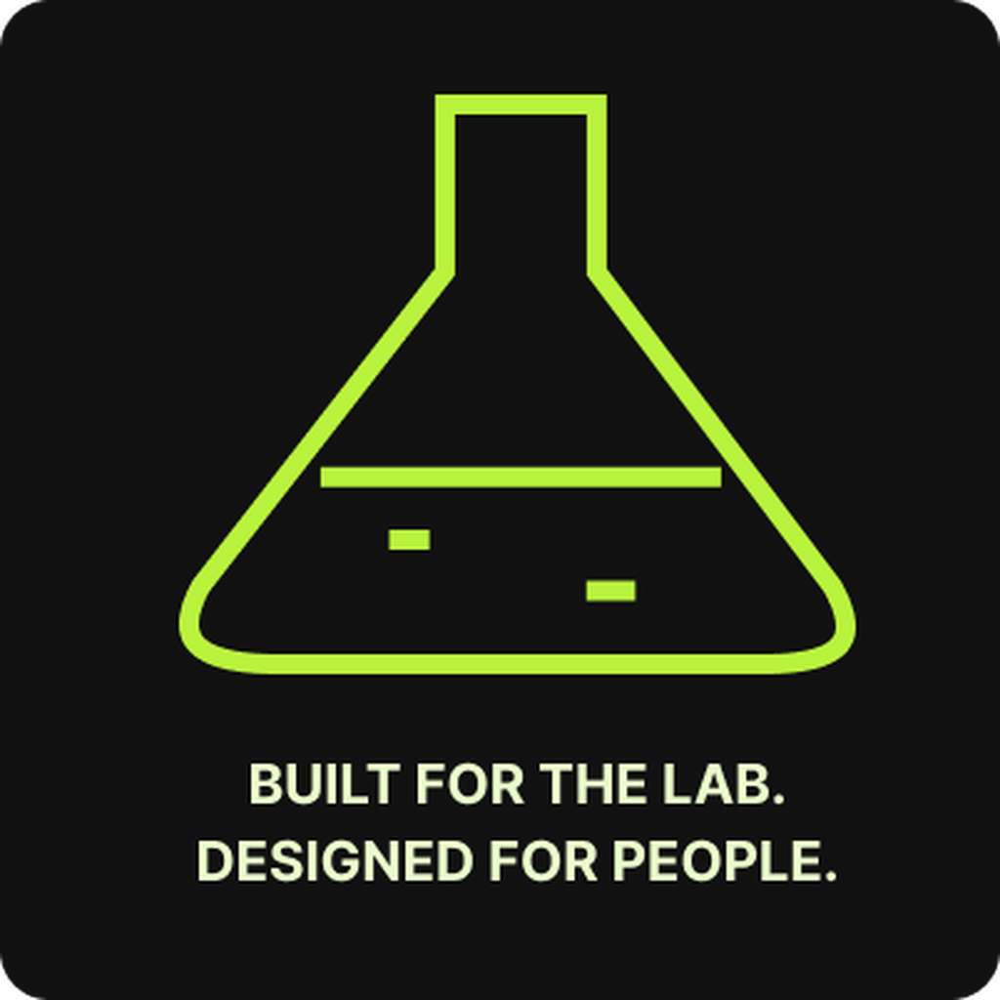
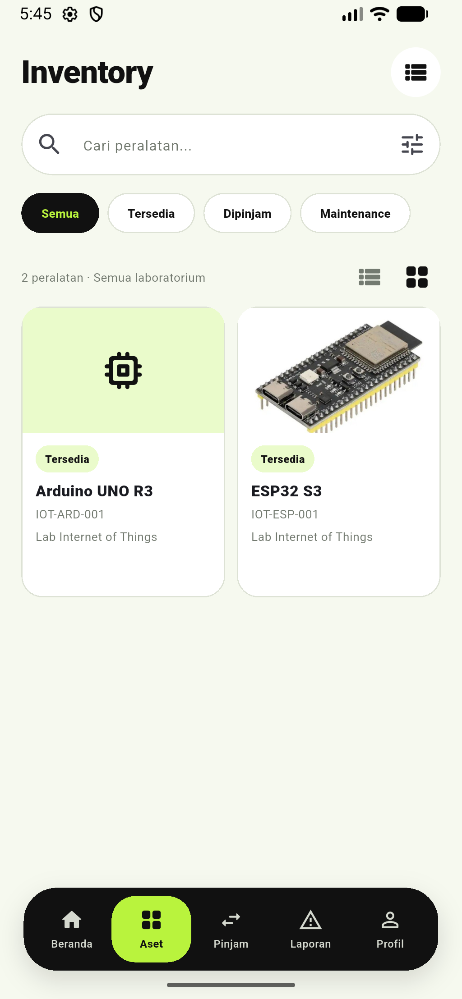
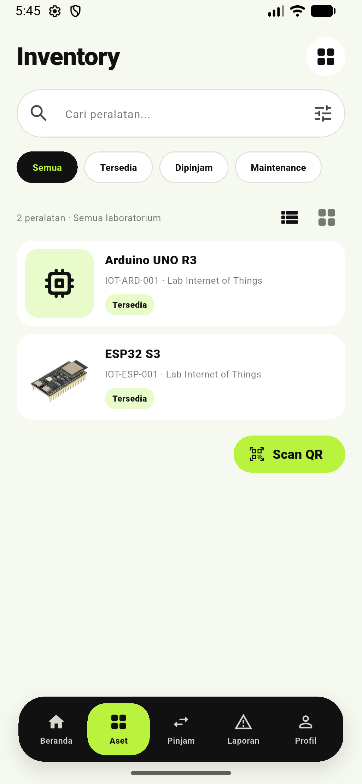

  

<h1 align="center">LabFlow</h1>

<strong>Laboratory Asset &amp; Service Management System</strong>

Aplikasi Android untuk inventaris, peminjaman, pelaporan, dan layanan laboratorium kampus.

  
  
  
  
  

LabFlow adalah proyek akademik untuk membantu mahasiswa, Lab Admin, dan pengelola sistem mengelola aset serta layanan laboratorium melalui aplikasi mobile. Aplikasi menggunakan Firebase Authentication dan Cloud Firestore dengan otorisasi berbasis role dan membership laboratorium.

> Status: **Academic/UAT build**. Source belum disiapkan untuk distribusi Play Store.

## Daftar Isi

1. [Tentang LabFlow](#tentang-labflow)
2. [Latar Belakang](#latar-belakang)
3. [Tujuan](#tujuan)
4. [Fitur](#fitur)
5. [Role dan Hak Akses](#role-dan-hak-akses)
6. [Application Preview](#application-preview)
7. [Tech Stack](#tech-stack)
8. [Arsitektur](#arsitektur)
9. [UML](#uml)
10. [ERD](#erd)
11. [Firestore Structure](#firestore-structure)
12. [Alur Bisnis](#alur-bisnis)
13. [Struktur Project](#struktur-project)
14. [Persyaratan Sistem](#persyaratan-sistem)
15. [Clone Repository](#clone-repository)
16. [Fork Workflow](#fork-workflow)
17. [Firebase Setup](#firebase-setup)
18. [Local Configuration](#local-configuration)
19. [Menjalankan Aplikasi](#menjalankan-aplikasi)
20. [Testing](#testing)
21. [Build APK](#build-apk)
22. [Security](#security)
23. [Session Management](#session-management)
24. [Notification](#notification)
25. [Offline Behavior](#offline-behavior)
26. [Known Limitations](#known-limitations)
27. [Contribution](#contribution)
28. [Roadmap](#roadmap)
29. [License](#license)
30. [Author](#author)

## Tentang LabFlow

LabFlow memusatkan aktivitas operasional laboratorium kampus dalam satu aplikasi Android. Student dapat menemukan aset, mengajukan peminjaman, mengikuti status permintaan, dan mengirim laporan. Lab Admin mengelola inventaris serta memproses peminjaman, laporan, dan maintenance pada laboratorium yang ditugaskan. Superadmin mengelola user, laboratorium, membership, dan activity log.

### Latar Belakang

Pengelolaan inventaris, peminjaman, dan laporan laboratorium sering tersebar di pencatatan manual dan komunikasi terpisah. Hal itu menyulitkan pelacakan status aset, tindak lanjut kerusakan, dan pembagian tanggung jawab. LabFlow menyediakan alur digital dengan status di Firestore dan akses yang dibatasi menurut role serta laboratorium.

### Tujuan

- Mendigitalisasi pencatatan aset dan aktivitas peminjaman.
- Membuat status permintaan, laporan, dan maintenance mudah dilacak.
- Menegakkan workflow berbeda untuk Student, Lab Admin, dan Superadmin.
- Menyediakan identifikasi aset melalui kode dan QR.
- Memisahkan state UI, navigasi, service, model domain, dan aturan akses backend.

## Fitur

| Fitur | Student | Lab Admin | Superadmin |
|---|:---:|:---:|:---:|
| Dashboard sesuai role | ✅ | ✅ | ✅ |
| Melihat/mencari katalog dan detail aset | ✅ | ✅ | — |
| Scan QR aset dengan kamera | ✅ | — | — |
| Membuat dan melacak permintaan peminjaman | ✅ | — | — |
| Membatalkan permintaan berstatus pending | ✅ | — | — |
| Menyetujui/menolak, assignment aset | — | ✅ | — |
| Verifikasi pickup, return, dan kondisi | — | ✅ | — |
| CRUD aset pada lab yang ditugaskan | — | ✅ | — |
| Membuat laporan laboratorium | ✅ | — | — |
| Melihat/membalas percakapan laporan | ✅ | ✅ | — |
| Menangani laporan dan membalas pesan | — | ✅ | — |
| Membuat dan memproses maintenance | — | ✅ | — |
| Notifikasi in-app | ✅ | — | — |
| Melihat/mengedit profil | ✅ | ✅ | ✅ |
| Kelola user, lab, dan membership | — | — | ✅ |
| Membaca activity log | — | — | ✅ |

Hak akses data tetap diputuskan oleh Firestore Security Rules, bukan hanya oleh tampilan aplikasi.

### Role dan Hak Akses

Perbedaan hak akses diberlakukan di UI dan Firestore Rules sesuai role aplikasi.

### Student

Dashboard, katalog aset dengan pencarian/filter dan tampilan grid/list, detail aset, pemindaian QR, permintaan/pelacakan/pembatalan peminjaman pending, laporan dan percakapan, notifikasi in-app, serta profil.

### Lab Admin

Dashboard dan inventaris sesuai membership aktif; CRUD aset dan foto; proses persetujuan/penolakan, assignment, verifikasi pickup/return dan kondisi; kelola laporan/percakapan dan maintenance; profil.

### Superadmin

Dashboard, manajemen user (buat/edit/aktifkan/suspend), laboratorium, membership Lab Admin, activity log, dan profil.

## Application Preview

Screenshot berikut berasal dari aplikasi. Gallery hanya memakai layar inventaris; screenshot UAT lain yang menampilkan nama akun atau form login tidak dipublikasikan.

  
  

<em>Katalog aset: tampilan grid dan list, pencarian/filter, serta akses scan QR.</em>

## Tech Stack

| Area | Teknologi |
|---|---|
| Mobile / bahasa | Flutter, Dart |
| State management | <code>flutter_bloc</code>, Cubit |
| Navigasi | GoRouter |
| Auth / database | Firebase Authentication, Cloud Firestore |
| Preferensi dan sesi lokal | SharedPreferences |
| QR | <code>qr_flutter</code>, <code>mobile_scanner</code> |
| Foto aset | <code>image_picker</code>, HTTP multipart, Cloudinary unsigned upload |
| Izin kamera | <code>permission_handler</code> |
| Test | Flutter Test, <code>bloc_test</code>, <code>mocktail</code> |

Dependency lengkap ada di <code>pubspec.yaml</code>. SDK Dart yang diminta <code>^3.13.4</code>. Versi Flutter tidak dikunci; pakai Flutter SDK yang menyertakan Dart sesuai constraint.

## Arsitektur

Kode disusun feature-first. Pola umum aplikasi:

~~~mermaid
flowchart TB
    actor["Pengguna Android"]
    ui["Flutter UI: pages dan widgets"]
    cubit["Cubit: state dan aksi UI"]
    service["Feature service"]
    auth["Firebase Authentication"]
    firestore[("Cloud Firestore")]
    cloudinary["Cloudinary: foto aset"]
    local["SharedPreferences: sesi lokal"]
    actor --> ui --> cubit --> service
    service --> auth
    service --> firestore
    service --> cloudinary
    cubit --> local
~~~

Cubit mengelola state dan menghubungkan interaksi halaman ke service. Service menjalankan operasi Firebase atau integrasi eksternal, sedangkan model domain memetakan dokumen. Tidak semua feature memisahkan repository/domain tersendiri; struktur mengikuti kompleksitas feature.

## UML

### UML — use case-like

~~~mermaid
flowchart LR
    student["Student"]
    admin["Lab Admin"]
    superadmin["Superadmin"]
    subgraph app["LabFlow"]
        catalog(["Telusuri aset dan scan QR"])
        borrow(["Ajukan dan lacak peminjaman"])
        report(["Laporan dan percakapan"])
        adminAssets(["Kelola aset laboratorium"])
        adminOps(["Proses borrowing, report, maintenance"])
        manage(["Kelola user, lab, membership"])
        logs(["Baca activity log"])
        profile(["Lihat dan edit profil"])
    end
    student --> catalog
    student --> borrow
    student --> report
    student --> profile
    admin --> catalog
    admin --> adminAssets
    admin --> adminOps
    admin --> profile
    superadmin --> manage
    superadmin --> logs
    superadmin --> profile
~~~

### UML — class diagram

Field berikut mewakili model domain utama, bukan daftar lengkap semua field Firestore.

~~~mermaid
classDiagram
    class UserProfile {
        +uid
        +email
        +fullName
        +role
        +status
    }
    class Laboratory {
        +id
        +name
        +code
        +location
        +status
    }
    class LabMembership {
        +id
        +userId
        +labId
        +role
        +active
    }
    class LaboratoryAsset {
        +id
        +labId
        +code
        +name
        +category
        +stock
        +status
        +condition
        +qrValue
        +imageUrl
    }
    class BorrowRequest {
        +id
        +requestNumber
        +studentId
        +labId
        +purpose
        +status
    }
    class BorrowRequestItem {
        +id
        +itemId
        +itemName
        +quantity
        +requestedAssetId
    }
    class PickupBorrowing {
        +id
        +requestId
        +requestItemId
        +studentId
        +assetId
        +quantity
        +status
    }
    class LabReport {
        +id
        +reporterId
        +labId
        +assetId
        +title
        +priority
        +status
    }
    class ReportMessage {
        +id
        +senderId
        +senderRole
        +text
    }
    class MaintenanceRecord {
        +id
        +labId
        +assetId
        +status
        +sourceType
        +sourceId
        +resolution
    }
    class StudentNotification {
        +id
        +type
        +targetType
        +targetId
        +read
    }
    UserProfile "1" --> "0..*" BorrowRequest : studentId
    Laboratory "1" --> "0..*" LaboratoryAsset : labId
    UserProfile "1" --> "0..*" LabMembership : userId
    Laboratory "1" --> "0..*" LabMembership : labId
    BorrowRequest "1" *-- "1..*" BorrowRequestItem : items
    BorrowRequest "1" --> "0..*" PickupBorrowing : requestId
    LaboratoryAsset "1" --> "0..*" PickupBorrowing : assetId
    LabReport "1" *-- "0..*" ReportMessage : messages
    LaboratoryAsset "0..1" --> "0..*" LabReport : assetId
    LaboratoryAsset "1" --> "0..*" MaintenanceRecord : assetId
~~~

## ERD

ERD ini adalah **relasi konseptual** untuk memahami dokumen/subcollection Firestore. Firestore tidak menerapkan foreign key atau join relational otomatis; referensi disimpan sebagai ID.

~~~mermaid
erDiagram
    USERS ||--o{ LAB_MEMBERSHIPS : assigned
    LABORATORIES ||--o{ LAB_MEMBERSHIPS : has
    LABORATORIES ||--o{ ASSETS : contains
    USERS ||--o{ BORROW_REQUESTS : submits
    LABORATORIES ||--o{ BORROW_REQUESTS : receives
    BORROW_REQUESTS ||--|{ BORROW_REQUEST_ITEMS : contains
    BORROW_REQUESTS ||--o{ BORROWINGS : fulfilled_by
    ASSETS ||--o{ BORROWINGS : assigned
    USERS ||--o{ REPORTS : submits
    LABORATORIES ||--o{ REPORTS : receives
    REPORTS ||--o{ REPORT_MESSAGES : contains
    ASSETS o|--o{ REPORTS : concerns
    LABORATORIES ||--o{ MAINTENANCE_RECORDS : tracks
    ASSETS ||--o{ MAINTENANCE_RECORDS : concerns
    USERS ||--o{ NOTIFICATIONS : receives
    USERS ||--o{ ACTIVITY_LOGS : actorUid
    USERS {
        string uid
        string email
        string fullName
        string role
        string status
    }
    LABORATORIES {
        string labId
        string name
        string code
        string location
        string status
    }
    LAB_MEMBERSHIPS {
        string membershipId
        string userId
        string labId
        string role
        boolean active
    }
    ASSETS {
        string assetId
        string labId
        string code
        string name
        int stock
        string status
        string condition
        string qrValue
    }
    BORROW_REQUESTS {
        string requestId
        string requestNumber
        string studentId
        string labId
        string status
    }
    BORROW_REQUEST_ITEMS {
        string itemId
        string itemName
        int quantity
        string requestedAssetId
    }
    BORROWINGS {
        string borrowingId
        string requestId
        string requestItemId
        string assetId
        int quantity
        string status
    }
    REPORTS {
        string reportId
        string reporterId
        string labId
        string assetId
        string title
        string priority
        string status
    }
    REPORT_MESSAGES {
        string messageId
        string senderId
        string senderRole
        string text
    }
    MAINTENANCE_RECORDS {
        string maintenanceId
        string labId
        string assetId
        string status
        string sourceType
        string sourceId
    }
    NOTIFICATIONS {
        string notificationId
        string studentId
        string type
        string targetId
        boolean read
    }
    ACTIVITY_LOGS {
        string activityId
        string actorUid
    }
~~~

## Firestore Structure

| Path | Isi |
|---|---|
| <code>users/{uid}</code> | Profil, role, status akun; UID mengikuti Firebase Auth. |
| <code>laboratories/{labId}</code> | Identitas dan status laboratorium. |
| <code>lab_memberships/{uid}__{labId}</code> | Membership Lab Admin; ID memakai dua underscore. |
| <code>assets/{assetId}</code> | Inventaris, stok, kondisi/status, QR, URL foto. |
| <code>borrow_requests/{requestId}</code> | Permintaan Student dan statusnya. |
| <code>borrow_requests/{requestId}/items/{itemId}</code> | Aset/jumlah yang diminta. |
| <code>borrowings/{borrowingId}</code> | Assignment per item, verifikasi pickup/return. |
| <code>reports/{reportId}</code> | Laporan dan tindak lanjut Lab Admin. |
| <code>reports/{reportId}/messages/{messageId}</code> | Percakapan pada laporan. |
| <code>maintenance_records/{maintenanceId}</code> | Pekerjaan maintenance manual atau terkait return/report. |
| <code>notifications/{notificationId}</code> | Notifikasi in-app Student dan target dokumen. |
| <code>activity_logs/{activityId}</code> | Activity log yang dapat dibaca Superadmin. |

<code>firestore.indexes.json</code> mendeklarasikan composite index laporan (<code>reporterId</code>, <code>updatedAt</code>) dan notifikasi (<code>studentId</code>, <code>createdAt</code>). Aturan akses dan validasi ada di <code>firebase/firestore.rules</code>.

## Alur Bisnis

### UML — borrowing sequence

Submit request membuat request dan item tanpa mengurangi stok. Stok baru dikurangi ketika Lab Admin menetapkan aset. Saat return, stok/kondisi diperbarui; kerusakan dapat membuat record maintenance.

~~~mermaid
sequenceDiagram
    actor Student
    participant App as LabFlow
    participant DB as Cloud Firestore
    actor Admin as Lab Admin
    Student->>App: Pilih aset, jumlah, tanggal, tujuan
    App->>DB: Buat request pending dan item
    DB->>App: Simpan tanpa mengurangi stok
    Admin->>App: Setujui atau tolak
    App->>DB: Update status request
    Admin->>App: Tetapkan aset
    App->>DB: Transaction: kurangi stok, buat borrowing, waiting_pickup
    Admin->>App: Verifikasi pickup
    App->>DB: Set status active
    Admin->>App: Periksa return dan kondisi
    App->>DB: Set returned; perbarui stok/kondisi/maintenance
    App->>Student: Tampilkan notifikasi status
~~~

### Borrowing lifecycle

~~~mermaid
stateDiagram-v2
    [*] --> pending
    pending --> approved: Disetujui Lab Admin
    pending --> rejected: Ditolak Lab Admin
    pending --> cancelled: Dibatalkan Student
    approved --> waiting_pickup: Aset ditetapkan
    waiting_pickup --> active: Pickup diverifikasi
    active --> returned: Return diperiksa
    rejected --> [*]
    cancelled --> [*]
    returned --> [*]
~~~

Status request dan status dokumen borrowing per item sama-sama dicatat. Request dapat memiliki beberapa item sehingga assignment dan pemeriksaan aset dikerjakan per item.

### Report dan percakapan

Student membuat report <code>open</code>. Lab Admin dapat mengubah ke <code>acknowledged</code>, <code>in_progress</code>, <code>resolved</code>, <code>closed</code>, atau <code>rejected</code> melalui transisi yang dibatasi Rules. Pesan berada pada subcollection report; pembaruan terkait menghasilkan notifikasi in-app.

~~~mermaid
sequenceDiagram
    actor Student
    participant App as LabFlow
    participant DB as Cloud Firestore
    actor Admin as Lab Admin
    Student->>App: Buat laporan
    App->>DB: Buat report open
    Admin->>App: Tinjau dan tangani
    App->>DB: Update status dan penanggung jawab
    Student->>App: Kirim pesan report
    Admin->>App: Balas dan lanjutkan tindak lanjut
    App->>DB: Simpan messages dan notification
    App->>Student: Tampilkan status/pesan terbaru
~~~

~~~mermaid
stateDiagram-v2
    [*] --> open
    open --> acknowledged: Diambil Lab Admin
    acknowledged --> in_progress: Penanganan dimulai
    in_progress --> resolved: Penanganan selesai
    resolved --> closed: Ditutup
    acknowledged --> rejected: Ditolak
    in_progress --> rejected: Ditolak
    closed --> [*]
    rejected --> [*]
~~~

## Struktur Project

~~~text
lib/
├── app/                 # app shell, theme, routing
├── core/                # session, storage, validators
├── features/
│   ├── asset/
│   ├── auth/
│   ├── borrowing/
│   ├── dashboard/
│   ├── lab_admin/
│   ├── laboratory/
│   ├── maintenance/
│   ├── onboarding/
│   ├── profile/
│   ├── reporting/
│   ├── splash/
│   ├── student/
│   └── superadmin/
├── shared/
├── firebase_options.dart
└── main.dart
firebase/
└── firestore.rules
firestore.indexes.json
~~~

## Persyaratan Sistem

- Git.
- Flutter SDK dengan Dart <code>^3.13.4</code> (cek <code>flutter doctor</code>).
- Android SDK dan emulator/perangkat Android. Manifest memerlukan izin kamera untuk scanner.
- JDK 17 untuk compile Java/Kotlin Android.
- Firebase CLI dan FlutterFire CLI hanya jika menyiapkan Firebase project atau mengelola Rules/indexes.

## Clone Repository

~~~bash
git clone https://github.com/Heat4Cliff/LabFlow_Academic.git
cd LabFlow_Academic
flutter pub get
~~~

Lanjutkan dengan setup Firebase dan konfigurasi lokal.

## Fork Workflow

1. Klik **Fork** di GitHub.
2. Clone fork, tambahkan remote upstream, lalu buat branch kerja.
3. Jalankan format, analyze, dan test yang relevan.
4. Push branch ke fork dan ajukan Pull Request ke <code>main</code>.

~~~bash
git clone https://github.com/<USERNAME>/LabFlow_Academic.git
cd LabFlow_Academic
git remote add upstream https://github.com/Heat4Cliff/LabFlow_Academic.git
git switch -c docs/describe-change
~~~

## Firebase Setup

Gunakan Firebase project yang Anda kelola sendiri; jangan arahkan fork ke project UAT pemilik repository.

1. Buat project Firebase dan daftarkan Android app dengan application ID <code>id.ac.unugha.labflow</code> (atau application ID fork Anda).
2. Aktifkan Email/Password pada Firebase Authentication.
3. Buat database Cloud Firestore.
4. Install/login Firebase CLI dan install FlutterFire CLI.
5. Dari root repository, konfigurasi Firebase Android:

~~~bash
flutterfire configure --platforms=android
~~~

FlutterFire membuat/memperbarui <code>lib/firebase_options.dart</code> dan konfigurasi Google Services Android. Firebase client config menunjuk ke project tertentu; jangan masukkan konfigurasi project pribadi ke Pull Request tanpa koordinasi maintainer.

Untuk project Anda sendiri, tinjau Rules/indexes lalu deploy:

~~~bash
firebase deploy --only firestore:rules,firestore:indexes --project <YOUR_FIREBASE_PROJECT_ID>
~~~

Deployment hanya ke project yang Anda miliki/kelola; clone dan run tidak melakukan deploy otomatis.

## Local Configuration

Upload foto aset memerlukan Cloudinary cloud name dan unsigned upload preset. Buat <code>config/dev.json</code> lokal (folder ini di-ignore Git):

~~~json
{
  "CLOUDINARY_CLOUD_NAME": "<YOUR_CLOUD_NAME>",
  "CLOUDINARY_UPLOAD_PRESET": "<YOUR_UNSIGNED_UPLOAD_PRESET>"
}
~~~

Batasi unsigned preset sesuai kebijakan layanan. **Jangan** menaruh Cloudinary API secret di aplikasi mobile. Source membatasi foto menjadi 5 MB dan JPG/JPEG/PNG/WEBP. Tanpa nilai konfigurasi, fitur selain upload tetap bisa digunakan.

Jangan commit <code>config/dev.json</code>, <code>.env*</code>, <code>docs/</code>, signing key, atau service-account credential.

## Menjalankan Aplikasi

~~~bash
flutter doctor
flutter pub get
flutter run --dart-define-from-file=config/dev.json
~~~

Untuk memilih emulator/perangkat:

~~~bash
flutter devices
flutter run -d <DEVICE_ID> --dart-define-from-file=config/dev.json
~~~

Akun sign-in harus dibuat pada Firebase Authentication dan memiliki dokumen <code>users/{uid}</code> sesuai role/status Rules. README tidak mempublikasikan akun/password demo.

## Testing

Jalankan dari root:

~~~bash
flutter analyze
flutter test
~~~

Test suite memakai Flutter Test, <code>bloc_test</code>, dan <code>mocktail</code>. Test otomatis bukan pengganti UAT kamera di perangkat, pemeriksaan Rules pada Firebase project, atau validasi signing release.

## Build APK

~~~bash
flutter build apk --release --dart-define-from-file=config/dev.json
~~~

APK dibuat di <code>build/app/outputs/flutter-apk/app-release.apk</code>. Gradle saat ini memakai debug signing config untuk build release. Hasil ini **bukan** APK untuk Play Store; siapkan release signing, application ID, versioning, pemeriksaan privacy/compliance, dan pengujian distribusi sebelum rilis publik.

## Security

- Firebase Authentication mengidentifikasi user; profil <code>users/{uid}</code> menentukan role/status.
- Firestore Rules memeriksa akun aktif, role, kepemilikan, dan membership aktif untuk operasi yang dibatasi per lab. Route guard UI bukan pengganti otorisasi server.
- Membership Lab Admin menggunakan ID <code>&lt;uid&gt;__&lt;labId&gt;</code> (dua underscore); helper Rules membentuk path yang sama.
- Percakapan report dibatasi ke pelapor dan Lab Admin ber-membership sesuai Rules. Source tidak mengklaim end-to-end encryption.
- Foto aset memakai Cloudinary unsigned preset; jangan sertakan API secret dalam binary. Batasi preset.
- Jangan commit password, token, Firebase Admin service account, private/release key, file konfigurasi lokal, atau secret.

## Session Management

Aplikasi menerapkan **batas sesi lokal satu jam** sejak login. UID dan waktu sesi disimpan melalui SharedPreferences; sesi dibersihkan ketika logout, invalid, kedaluwarsa, atau tidak cocok dengan UID aktif.

Kebijakan ini terpisah dari persistence/masa berlaku token Firebase Authentication. Ini adalah kontrol sesi aplikasi, bukan pencabutan token Firebase di server tepat pada menit ke-60.

## Notification

Notifikasi tersedia sebagai **in-app realtime notification** dari Firestore, dengan unread badge. Source belum menggunakan Firebase Cloud Messaging (<code>firebase_messaging</code>); push ke notification tray Android saat aplikasi di latar belakang/tertutup belum tersedia.

## Offline Behavior

LabFlow adalah aplikasi **online-first**. Cache Firestore untuk data tertentu tidak menjadikan semua workflow siap offline. Login, perubahan data, assignment, verifikasi, dan sinkronisasi membutuhkan jaringan.

## Known Limitations

- Build/configuration yang ada berfokus pada Android.
- Foto hanya tersedia untuk aset; report belum mendukung attachment foto.
- Notifikasi masih in-app; FCM push belum diimplementasikan.
- Tidak ada janji offline-first atau sinkronisasi semua perubahan offline.
- APK release masih memakai debug signing config dan belum siap untuk distribusi store.
- Repository tidak menyediakan pipeline CI/coverage untuk badge status.
- UAT tetap perlu Firebase project dan perangkat/emulator yang dikonfigurasi.

## Contribution

Kontribusi dapat dikirim lewat fork dan Pull Request. Gunakan branch terfokus seperti <code>feature/...</code>, <code>fix/...</code>, <code>refactor/...</code>, <code>test/...</code>, atau <code>docs/...</code>. Jalankan formatter pada file Dart yang berubah, <code>flutter analyze</code>, dan <code>flutter test</code>. Sebelum push, tinjau <code>git diff</code> dan pastikan konfigurasi lokal/credential tidak ikut.

## Roadmap

Prioritas lanjutan sesuai batas source saat ini:

- UAT end-to-end tambahan pada perangkat Android fisik.
- Firebase Cloud Messaging bila push notification diperlukan.
- Offline sync dengan strategi konflik/retry yang jelas.
- Attachment report setelah workflow dan storage policy disepakati.
- Release signing serta pemeriksaan distribusi sebelum rilis Play Store.
- Perluasan integration test dan validasi Security Rules otomatis.

## License

Repository ini belum mendeklarasikan lisensi open-source formal. Penggunaan ulang/distribusi perlu mengikuti ketentuan pemilik repository sampai file lisensi ditambahkan.

## Author

**Mohammad Alwan Abbas Abdillah** 
Program Studi Informatika 
Universitas Nahdlatul Ulama Al-Ghazali (UNUGHA) Cilacap
